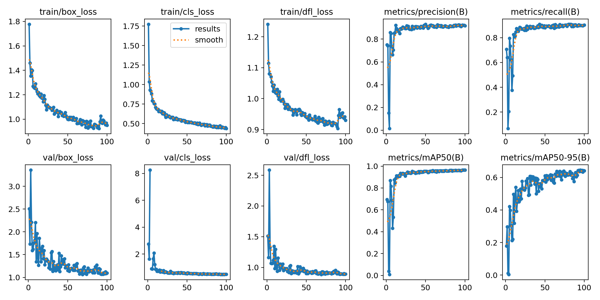
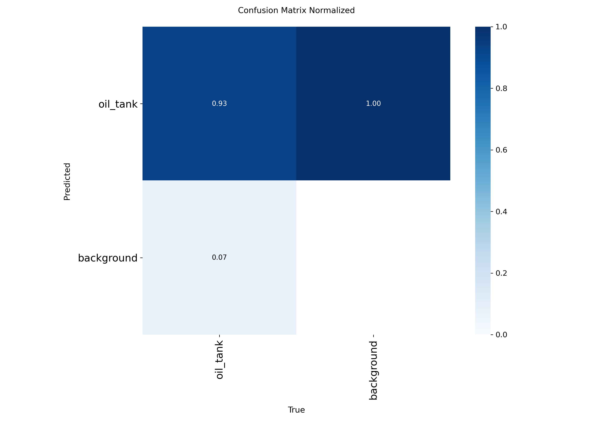
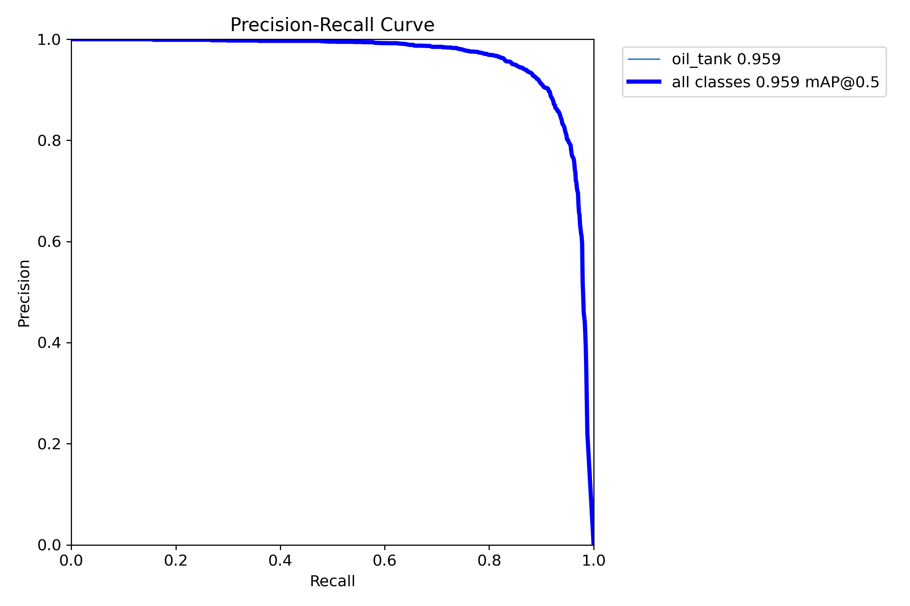
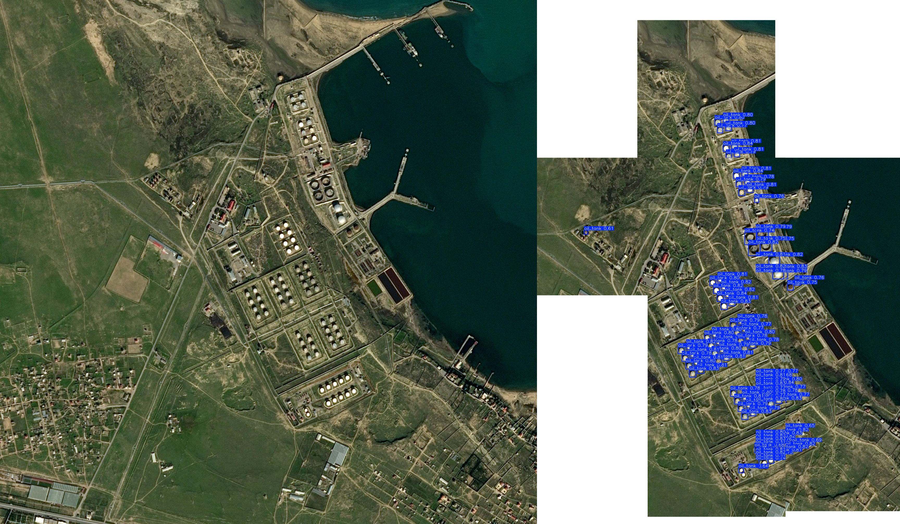

# Satellite Oil Storage Tank Detection

A professional machine learning pipeline for detecting oil storage tanks in high-resolution satellite imagery using YOLOv8. This project implements a full end-to-end workflow including data preprocessing, intelligent tiling, model training, and performance evaluation.

## Workflow Overview

The project follows a modular pipeline designed for high-resolution geospatial data:

1.  **Data Ingestion**: Processes the Airbus Oil Storage Detection dataset, consisting of high-resolution JPEG images and CSV annotations.
2.  **Preprocessing & Tiling**: 
    - **Tiling Strategy**: Satellite images are often too large (several thousand pixels) to be fed directly into a CNN without significant detail loss. We implement a tiling strategy using a **640x640 window** with a **512-pixel stride** (ensuring overlap to avoid cutting objects at edges).
    - **Filtering**: Only tiles containing oil tanks are retained for training to maintain a balanced dataset and reduce computational overhead.
    - **Normalization**: Conversion of bounding box coordinates from pixel-absolute to YOLO-normalized format.
3.  **Model Training**:
    - **Architecture**: YOLOv8s (Small) — selected for its optimal balance between inference speed and detection accuracy.
    - **Hyperparameters**: 100 epochs, image size 640, AdamW optimizer, and mosaic augmentation.
    - **Augmentation**: Applied 90-degree rotations, horizontal/vertical flips, and HSV adjustments to increase model robustness against varying satellite orientations and lighting conditions.

## 📁 Project Structure

```text
oil_tank_project/
├── oil-storage-detection.ipynb  # Primary exploration and training notebook
├── tiled_dataset.yaml           # YOLO configuration for the processed data
├── tiled/                       # Generated dataset (images & labels)
│   ├── images/ (train/val)
│   └── labels/ (train/val)
└── runs/detect/train/           # Training artifacts and metrics
    ├── weights/ (best.pt, last.pt)
    ├── results.csv              # Raw metrics per epoch
    ├── results.png              # Learning curves
    └── confusion_matrix.png     # Error analysis
```

## Implementation Pipeline

### 1. Environment Setup
Installed required libraries:
- NumPy, Pandas → data handling  
- OpenCV → image processing  
- Ultralytics YOLOv8 → object detection  

---

### 2. Dataset Loading
Used Airbus Oil Storage Detection dataset from Kaggle:
[Airbus Oil Storage Detection Dataset](https://www.kaggle.com/datasets/airbusgeo/airbus-oil-storage-detection-dataset)

---

### 3. Annotation Parsing
Bounding boxes were provided in `(x_min, y_min, x_max, y_max)` format and converted into numerical values.

---

### 4. YOLO Format Conversion
Converted annotations into YOLO format:
`(class_id, x_center, y_center, width, height)`

All values normalized with respect to image dimensions.

---

### 5. Dataset Organization
Created directory structure: 
```text
data/
├── images/train
├── images/val
├── labels/train
├── labels/val
```

---

### 6. Tiling Strategy
Implemented tiling to handle large images:
- Tile size: 640×640  
- Overlap to avoid object truncation  
- Removed empty tiles  

---

### 7. Tile Generation
Generated tiles and adjusted bounding boxes relative to each tile.

---

### 8. Dataset Configuration
Created YOLO config file:

```yaml
path: tiled
train: images/train
val: images/val

names:
  0: oil_tank
```

---

### 9. Model Training
Trained YOLOv8 model using transfer learning:

```python
model.train(
    data="tiled_dataset.yaml",
    epochs=100,
    imgsz=640,
    batch=16,
    degrees=90,
    flipud=0.5,
    fliplr=0.5
)
```

---

### 10. Evaluation
Evaluated using:
- mAP@50
- mAP@50-95
- Precision & Recall

---

### 11. Key Observations
- Tiling significantly improved small object detection.
- Dense regions caused overlapping predictions.
- Adjusted confidence and NMS to improve results.

---


## Model Performance

The model achieved high precision and recall, demonstrating robust detection capabilities across the validation set.

| Metric | Value |
| :--- | :--- |
| **mAP@50** | **0.964** |
| **mAP@50-95** | **0.641** |
| **Precision** | **0.917** |
| **Recall** | **0.903** |

### Training Results

*Figure 1: Training and Validation Loss/Metric curves over 100 epochs.*

### Error Analysis & Precision-Recall

*Figure 2: Normalized Confusion Matrix showing high accuracy for the 'oil_tank' class.*


*Figure 3: Precision-Recall Curve demonstrating the trade-off at various thresholds.*

## Inference (How to Use the Model)

```python
from ultralytics import YOLO

# Load trained model
model = YOLO("runs/detect/train/weights/best.pt")

# Run inference
results = model.predict(
    source="path_to_image_or_folder",
    conf=0.6,
    iou=0.3,
    save=True
)
```

**Output**:
- Bounding boxes with confidence scores.
- Saved results in `runs/detect/predict/`.

## Tiling Strategy Impact

| Feature | Before Tiling | After Tiling |
| :--- | :--- | :--- |
| **Object Size** | Objects are extremely small | Objects become larger and clearer |
| **Detection Quality** | Poor detection of small tanks | Improved recall and detection accuracy |
| **Reliability** | High false negatives | Better performance in dense regions |


*Figure 4: Tiling impact comparison — Left: Original high-resolution image; Right: After tiling and labeling.*


> [!IMPORTANT]
> **Key Insight**: Satellite imagery presents a small object detection challenge due to high resolution and large spatial coverage. 
> 
> **Solution**:
> - Applied tiling (640×640 with overlap)
> - Improved feature visibility
> - Enabled robust detection of small objects

### Final Impact
This project demonstrates a production-ready approach to solving small object detection in satellite imagery using tiling, transfer learning, and optimized inference strategies.


## Assumptions & Challenges

### Assumptions
- **Static Background**: High-resolution imagery is assumed to be orthorectified.
- **Single Class**: The current implementation focuses exclusively on `oil_storage_tank`, treating other industrial structures as background.

### Challenges
- **Pixel Scale**: Small tanks appear as tiny pixel clusters in global views. Tiling was **mandatory** rather than optional to preserve the feature resolution (GSD).
- **Class Imbalance**: Large swathes of satellite images are empty. The pipeline filters these to ensure the gradient updates are meaningful.

## Potential Improvements

- **SAHI Integration**: Implement *Slicing Aided Hyper Inference* (SAHI) during deployment to run inference on overlapping tiles and merge results, which typically boosts small object detection.
- **Model Scaling**: Upgrade to YOLOv8m or YOLOv8l for higher feature extraction depth if computational budget allows.
- **Multi-Spectral Data**: Incorporate Near-Infrared (NIR) bands if available, as oil tanks often have distinct thermal/reflective signatures.
- **Temporal Analysis**: Apply the model across time-series data to track volume changes or industrial activity levels.

## Acknowledgment

This project also draws inspiration from the Image Tile Selector & BBox Annotator tool developed by the SkyServe AI team.

🔗 https://github.com/SkyServe-AI/tile-bbox-exporter

I studied their approach and adapted the tiling concept into my pipeline, particularly:

- Efficient handling of large satellite imagery
- Structured tiling strategies for downstream ML tasks

