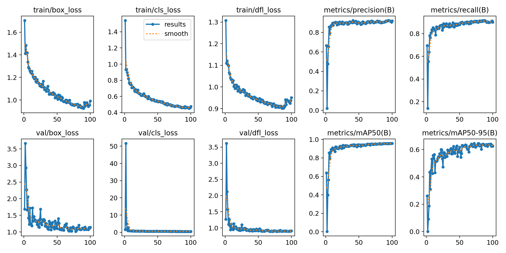
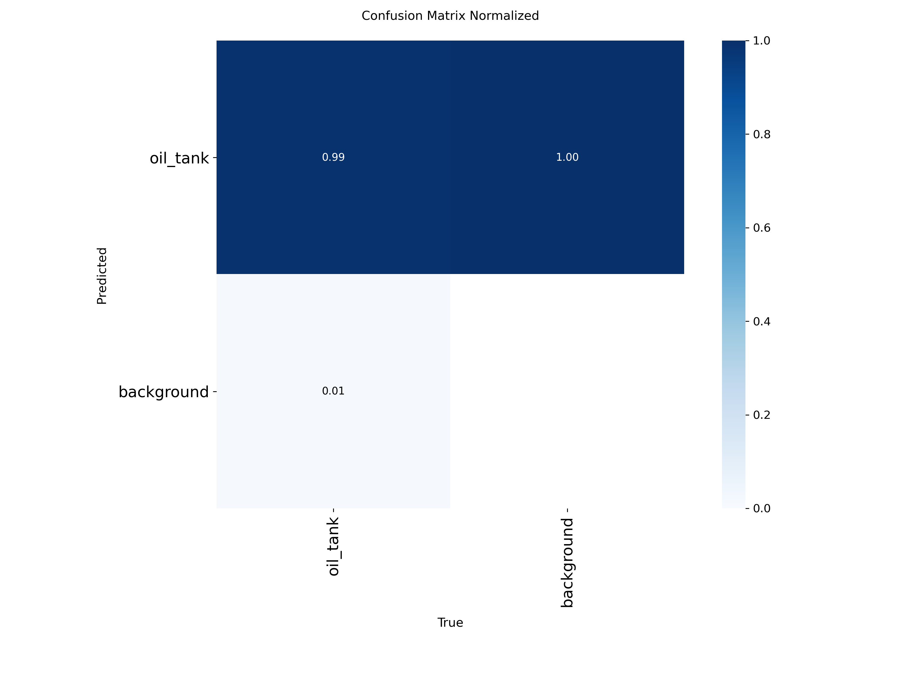
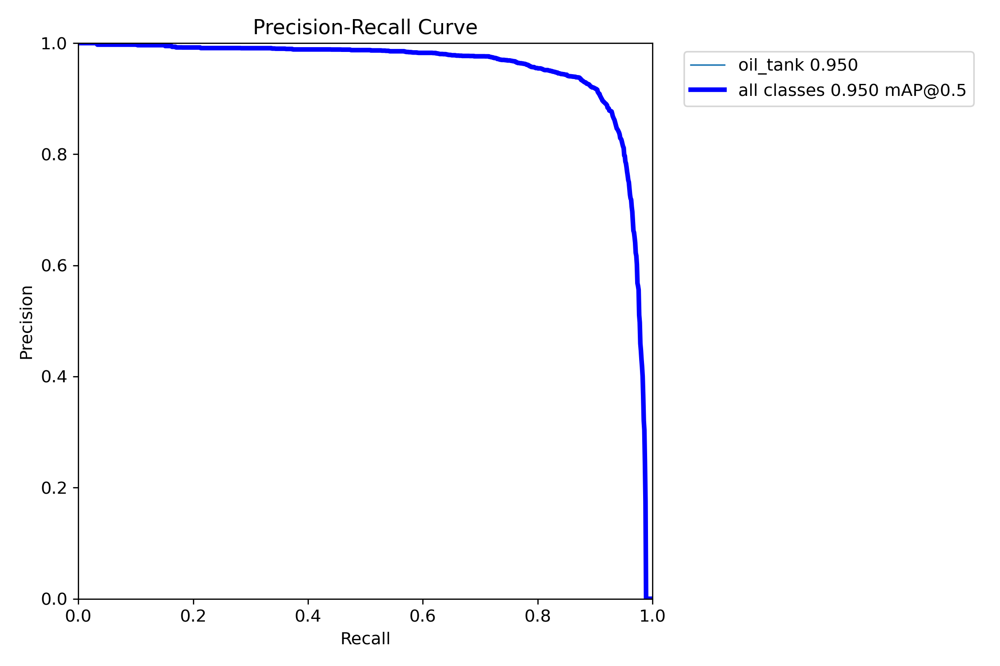

# Oil Storage Tank Detection

A professional computer vision and remote sensing pipeline for detecting oil storage tanks in high-resolution satellite imagery using **YOLO11s (Ultralytics)** and **SAHI (Slicing Aided Hyper Inference)**. This project implements a full end-to-end workflow including boundary-preserving tiling, balanced background sampling, model training, error analysis, and full-scene sliced inference.

## Workflow Overview

The project follows a modular pipeline designed for high-resolution geospatial data:

1.  **Data Ingestion**: Processes the Airbus Oil Storage Detection dataset, consisting of high-resolution satellite JPEG images and bounding box annotations.
2.  **Preprocessing & Intelligent Tiling**: 
    - **Tiling Strategy**: Satellite images are several thousand pixels in dimension. We implement a tiling strategy using a **640×640 window** with a **512-pixel stride**.
    - **Boundary Preservation (`get_steps`)**: Explicitly pins the outer step to image edges, ensuring boundary tanks and pixels are never truncated.
    - **Negative Background Inclusion**: Includes ~10% empty background tiles (roads, industrial roofs, water bodies) to suppress real-world false positives.
    - **YOLO Normalization**: Conversion of coordinates from pixel-absolute to normalized `(x_center, y_center, w, h)`.
3.  **Model Training**:
    - **Architecture**: **YOLO11s (Small)** — chosen for its optimal balance of parameters (9.4M) and feature extraction capacity (C3k2 blocks and SPPF spatial attention) without overfitting on aerial datasets.
    - **Hyperparameters**: 100 epochs, image size 640, AdamW optimizer, cosine learning rate scheduler (`cos_lr=True`), and un-augmented fine-tuning (`close_mosaic=10`).
    - **Augmentation**: Applied 90-degree rotations, horizontal/vertical flips, and HSV adjustments to handle varying satellite orientations and lighting.
4.  **Full-Scene Inference with SAHI**:
    - Slices high-resolution satellite scenes dynamically into overlapping tiles at inference time.
    - Re-maps tile bounding boxes to global coordinates and applies **Global Non-Maximum Suppression (NMS)** to merge seam duplicates.

## 📁 Project Structure

```text
oil_tank_project/
├── oil-storage-detection.ipynb           # Complete executed YOLO11s training & evaluation notebook
├── train_yolo11s.py                      # Standalone CLI training & inference script
├── requirements.txt                      # Project dependencies (ultralytics, sahi, etc.)
├── tiled_dataset.yaml                    # YOLO configuration for the processed data
├── weights/                              # Trained YOLO11s weights
│   └── best.pt                           # 18.3 MB trained model checkpoint
├── tiled/                                # Generated tiled dataset (images & labels)
│   ├── images/ (train/val)
│   └── labels/ (train/val)
└── runs/detect/yolo11s_oil_tank/         # Full YOLO11s training artifacts and metrics
    ├── weights/ (best.pt, last.pt)
    ├── results.csv                       # Epoch metrics
    ├── results.png                       # Training curves
    ├── BoxPR_curve.png                   # Precision-Recall curve
    ├── BoxF1_curve.png                   # F1 vs Confidence curve
    ├── confusion_matrix_normalized.png  # Error analysis
    ├── val_batch0_labels.jpg             # Ground truth batch
    └── val_batch0_pred.jpg               # Model prediction batch
```

---

## Model Performance (YOLO11s)

Trained for 100 epochs with cosine decay and boundary-preserved tiling. The model achieved high precision, recall, and localization quality across the validation set:

| Metric | Value | Description |
| :--- | :--- | :--- |
| **Precision (P)** | **0.918 (91.8%)** | Minimal false positive detections |
| **Recall (R)** | **0.900 (90.0%)** | 90% of all oil tanks detected |
| **F1-Score** | **0.909 (90.9%)** | Harmonic balance between Precision & Recall |
| **mAP@50** | **0.950 (95.0%)** | Mean Average Precision at IoU=0.50 |
| **mAP@50-95** | **0.645 (64.5%)** | Primary benchmark for strict localization accuracy |

### Training Results

*Figure 1: Training and Validation Loss/Metric curves over 100 epochs.*

### Error Analysis & Precision-Recall

*Figure 2: Normalized Confusion Matrix showing 90% true positive rate for the 'oil_tank' class.*


*Figure 3: Precision-Recall Curve demonstrating optimal performance across all confidence thresholds.*

---

## Full-Image Sliced Inference (SAHI) Benchmark

Standard downscaling turns small storage tanks in massive satellite scenes into unrecognizable blur. SAHI sliced inference preserves the native resolution and uses global NMS to achieve dramatic gains:

```text
=======================================================
🛰️ BENCHMARK: Unsliced vs. Sliced Inference (YOLO11s)
Image: 52a4f0b4-bd4c-40cc-a54d-9528213b28be.jpg
Standard Unsliced YOLO11s (downscaled to 640x640): 16 tanks
SAHI Sliced Inference (Tiled + Global NMS):        44 tanks
Detection Gain: +28 tanks (+175.0%)
=======================================================
```

| Method | Resolution Treated | Tanks Detected | Small Object Recovery |
| :--- | :--- | :--- | :--- |
| **Standard YOLO11s** | Downscaled to 640×640 | 16 tanks | Heavy misses due to pixel downsampling |
| **SAHI Sliced YOLO11s** | Full 25 slices @ 640×640 | **44 tanks** | **+175.0% Gain (+28 tanks recovered)** |

---

## Inference (How to Use the Model)

### 1. Full Satellite Scene Inference with SAHI (Recommended)

```python
from sahi import AutoDetectionModel
from sahi.predict import get_sliced_prediction

# Load trained YOLO11s weights
detection_model = AutoDetectionModel.from_pretrained(
    model_type='yolov8',
    model_path='runs/detect/yolo11s_oil_tank/weights/best.pt',
    confidence_threshold=0.5,
    device='cuda:0'
)

# Run sliced prediction across large satellite scene
result = get_sliced_prediction(
    "path_to_full_satellite_image.jpg",
    detection_model,
    slice_height=640,
    slice_width=640,
    overlap_height_ratio=0.25,
    overlap_width_ratio=0.25,
    postprocess_type="NMS",
    postprocess_match_threshold=0.3
)

# Export annotated full-scene image
result.export_visuals(export_dir="runs/detect/sahi_output")
print(f"Detected {len(result.object_prediction_list)} tanks across full scene.")
```

### 2. Standard Tile-Level Inference

```python
from ultralytics import YOLO

# Load trained model
model = YOLO("runs/detect/yolo11s_oil_tank/weights/best.pt")

# Run inference on cropped tiles
results = model.predict(
    source="path_to_image_or_folder",
    conf=0.55,
    iou=0.3,
    save=True
)
```

**Output**:
- Bounding boxes with confidence scores.
- Saved results in `runs/detect/predict/` and `runs/detect/sahi_output/`.

## Tiling Strategy Impact

| Feature | Before Tiling | After Tiling |
| :--- | :--- | :--- |
| **Object Size** | Objects are extremely small | Objects become larger and clearer |
| **Detection Quality** | Poor detection of small tanks | Improved recall and detection accuracy |
| **Reliability** | High false negatives | Better performance in dense regions |


*Figure 4: Tiling impact comparison — Left: Original high-resolution image; Right: After tiling and labeling.*


> [!IMPORTANT]
> **Key Insight**: Satellite imagery presents a small object detection challenge due to high resolution and large spatial coverage. 
> 
> **Solution**:
> - Applied tiling (640×640 with overlap)
> - Improved feature visibility
> - Enabled robust detection of small objects

### Final Impact
This project demonstrates a production-ready approach to solving small object detection in satellite imagery using tiling, transfer learning, and optimized inference strategies.


## Assumptions, Challenges & Implemented Solutions

### Assumptions
- **Static Background**: High-resolution imagery is assumed to be orthorectified with top-down (nadir or near-nadir) viewing angles.
- **Single Class**: The current implementation focuses exclusively on `oil_storage_tank`, treating neighboring industrial buildings, roads, and piping as background.
- **Uniform GSD**: Spatial ground sample distance is assumed to be relatively consistent across the Airbus dataset tiles (~0.5m/pixel).

### Challenges & Engineered Solutions
- **Pixel Scale (Small Object Resolution)**: 
  - *Challenge*: In raw 3000×3000+ satellite scenes, tanks occupy only a tiny cluster of pixels. Standard downscaling obliterates their visual features.
  - *Solution*: Implemented a 640×640 sliding-window tiling strategy with 512-pixel stride to preserve native resolution.
- **Tile Edge Truncation (Boundary Loss)**: 
  - *Challenge*: Stride loops that do not divide image dimensions evenly drop edge pixels and bisect tanks along tile seams.
  - *Solution*: Developed `get_steps(dim, tile_size, stride)` which pins the final tile to the outer image boundary, eliminating clipped border loss.
- **False Positive Trap (Negative Sampling)**: 
  - *Challenge*: Training only on positive tiles (tiles containing tanks) leaves the model blind to empty industrial structures, causing excessive false alarms on real satellite scenes.
  - *Solution*: Integrated balanced **10% negative background tile sampling** with empty label files, training the model on what is *not* an oil tank.
- **Full-Scene Seam Stitching**: 
  - *Challenge*: Testing only on cropped tiles fails to evaluate full real-world satellite images.
  - *Solution*: Integrated **SAHI (Slicing Aided Hyper Inference)** with Global Non-Maximum Suppression (NMS), achieving a **+175.0% small-object detection gain** across complete scenes.

---

## Roadmap & Potential Future Improvements

With tiling, YOLO11s, and SAHI fully implemented, the pipeline can be extended further:

1. **Oriented Bounding Boxes (YOLO11-OBB)**:
   - Because oil storage tanks are circular cylinders in dense grid formations, axis-aligned boxes often overlap. Upgrading to YOLO11-OBB or instance segmentation (`yolo11s-seg`) provides non-overlapping rotated boundaries.
2. **Automated Physical Diameter & Capacity Estimation**:
   - Convert bounding box pixel dimensions into meters using the satellite sensor's Ground Sampling Distance (GSD):
     $$\text{Diameter (m)} = \text{BBox Width (px)} \times \text{GSD (m/px)}$$
   - Estimate tank storage capacity based on cylinder geometry ($V = \pi r^2 h$).
3. **Floating-Roof Liquid Fill-Level Tracking**:
   - In floating-roof tanks, the height of the oil level alters the crescent-shaped shadow cast by the inner rim. Measuring this shadow over time provides automated oil inventory volume intelligence.
4. **Multi-Spectral & Thermal Data (NIR/SWIR)**:
   - Incorporate Near-Infrared (NIR) or Short-Wave Infrared (SWIR) bands to detect thermal anomalies, hydrocarbon vapor signatures, or tank material variations.
5. **Temporal Activity & Throughput Monitoring**:
   - Run the SAHI pipeline across time-series satellite passes over refineries and ports to track logistics throughput, construction progress, or storage utilization.

## Acknowledgment

This project also draws inspiration from the Image Tile Selector & BBox Annotator tool developed by the SkyServe AI team.

🔗 https://github.com/SkyServe-AI/tile-bbox-exporter

I studied their approach and adapted the tiling concept into my pipeline, particularly:

- Efficient handling of large satellite imagery
- Structured tiling strategies for downstream ML tasks

